# PriceIQ — Competitor Price Intelligence & Product Comparison

> **In one sentence:** PriceIQ collects product data from two online stores, works out which products are
> "the same thing" in both, and shows a business user — in an interactive dashboard — where they are cheaper,
> where they are more expensive, by how much, and what to do about it.

<p align="center">
  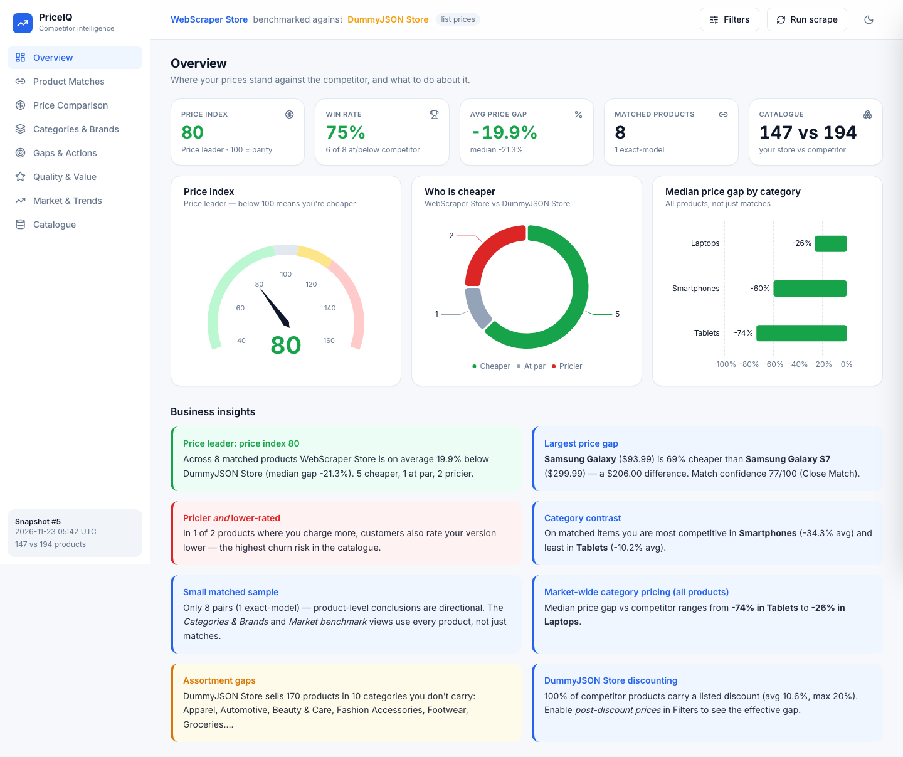
</p>

**Contents**
1. [What problem does this solve?](#1-what-problem-does-this-solve)
2. [What you see in the app](#2-what-you-see-in-the-app)
3. [Where the data comes from](#3-where-the-data-comes-from-and-an-honest-warning)
4. [Quick start](#4-quick-start)
5. [How it works, end to end](#5-how-it-works-end-to-end)
6. [Key concepts (glossary)](#6-key-concepts-glossary)
7. [Project structure — every file explained](#7-project-structure--every-file-explained)
8. [The matching algorithm in detail](#8-the-matching-algorithm-in-detail)
9. [The recommendation rules](#9-the-recommendation-rules)
10. [API reference](#10-api-reference)
11. [Database](#11-database)
12. [Frontend architecture](#12-frontend-architecture)
13. [How to extend it](#13-how-to-extend-it)
14. [Testing & commands](#14-testing--commands)
15. [Limitations, ethics & troubleshooting](#15-limitations-ethics--troubleshooting)

---

## 1. What problem does this solve?

Imagine you run an online shop. Your competitor sells similar things. You want to know:

* Which of my products are **cheaper / more expensive** than theirs?
* **By how much**, and in which categories is the gap biggest?
* Where am I leaving money on the table (priced far *below* the competitor)?
* Where might I be losing customers (priced far *above*, and rated *lower*)?
* Which products does the competitor sell that I don't?

Doing this by hand means opening two websites and comparing hundreds of products. PriceIQ automates it:

```
  Store A (yours)  ─┐                                         ┌─►  charts, tables, insights,
                    ├─►  scrape ─► clean ─► match ─► analyse ─┤    and pricing recommendations
  Store B (rival)  ─┘                                         └─►  in a web dashboard
```

The hard part is **matching**: store A calls a product `Asus VivoBook X441NA-GA190` and store B calls a similar
one `Asus Zenbook Pro Dual Screen Laptop`. The app uses brand, name similarity, description similarity and
specifications to decide whether two listings are the same (or comparable) product, and tells you *how confident*
it is.

---

## 2. What you see in the app

The dashboard has a left sidebar with 8 pages, and a **Filters** drawer + **Run scrape** button at the top.

| Page | Question it answers | Main content |
|---|---|---|
| **Overview** | "How competitive am I overall?" | KPI cards (price index, win rate, average gap), a gauge, a cheaper/at-par/pricier donut, price gap per category, plus plain-English **business insights**. |
| **Product Matches** | "Which products matched, and how do they compare?" | Searchable/sortable table of matched pairs; click a row for a **side-by-side** panel with both products' image, price, rating and description. CSV export. |
| **Price Comparison** | "Where exactly do prices differ?" | Scatter plot (your price vs theirs), a "price ladder" showing each pair's gap, and a table of who is cheaper per category. |
| **Categories & Brands** | "What's the average price difference per category?" | Median price per category in both stores, % gap per category, same-brand/same-category gaps, summary table. Uses **all** products, not only matched ones. |
| **Gaps & Actions** | "Where are the biggest gaps and what should I change?" | Top over-priced / under-priced products, **pricing recommendations** (reduce / raise / hold / review) with adjustable policy sliders, and a **market benchmark** that positions *every* product of yours against the competitor's price range. |
| **Quality & Value** | "Is a higher price justified by better ratings?" | A quadrant chart (price gap vs rating gap) that flags "pricier *and* lower rated" products, and a price-vs-rating value map per category. |
| **Market & Trends** | "What is the competitor doing over time, and what do they sell that I don't?" | Price trend lines across scrapes, competitor discount strategy, assortment gaps, price-tier mix, competitor products low on stock. |
| **Catalogue** | "Show me the raw product lists." | Both stores' full product lists with search, category filter and CSV export. |

**Filters** (top-right button) are deliberately limited to business choices:
*Match reliability* (all / medium+high / high only), *compare post-discount prices*, *price tolerance* (what counts as "at par"),
and *category selection*. A dark/light theme toggle sits next to it.

### Screenshots

> Captured from the real running app on the demo data (see [section 3](#3-where-the-data-comes-from-and-an-honest-warning) for why the numbers are synthetic).

**Overview** — headline KPIs, the price-index gauge and plain-English insights.


**Product Matches** — every matched pair, sortable and filterable…
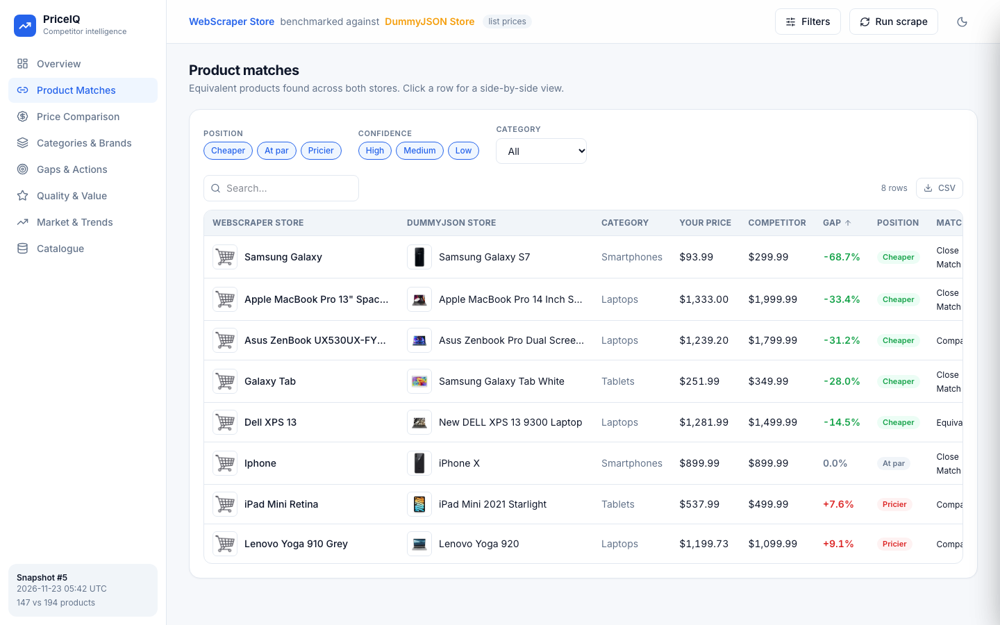

…and clicking a row opens a **side-by-side** comparison of the two products.
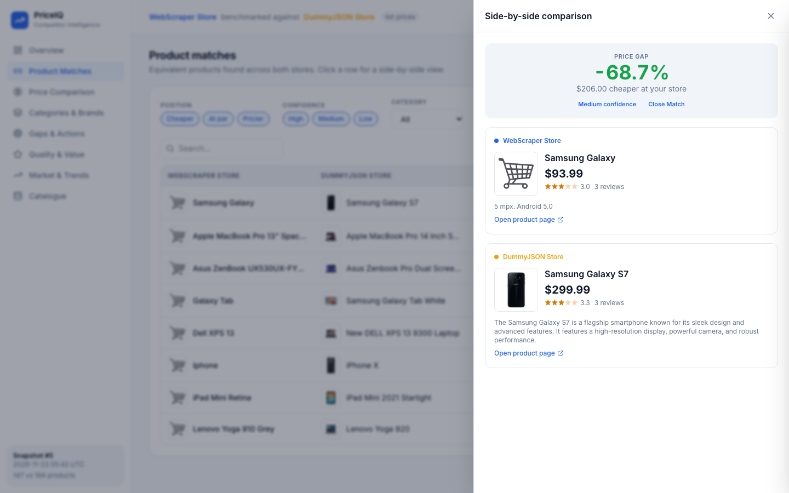

**Price Comparison** — price-vs-price scatter and the per-pair price ladder.
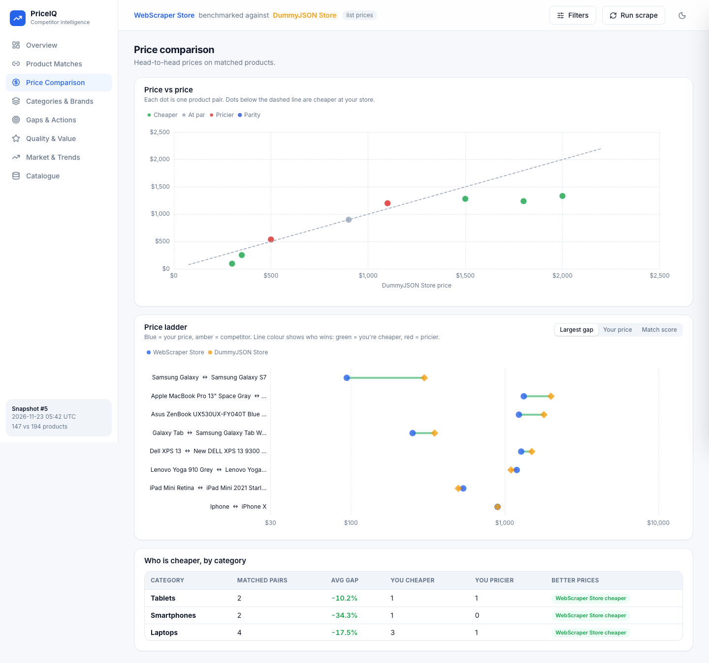

**Categories & Brands** — typical price and % gap per category across the whole catalogue.
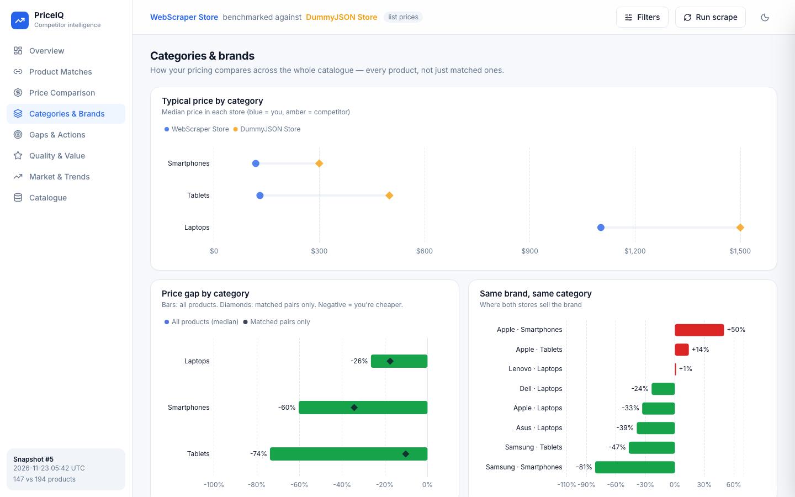

**Gaps & Actions** — biggest gaps, pricing recommendations with adjustable policy sliders, and a market benchmark.
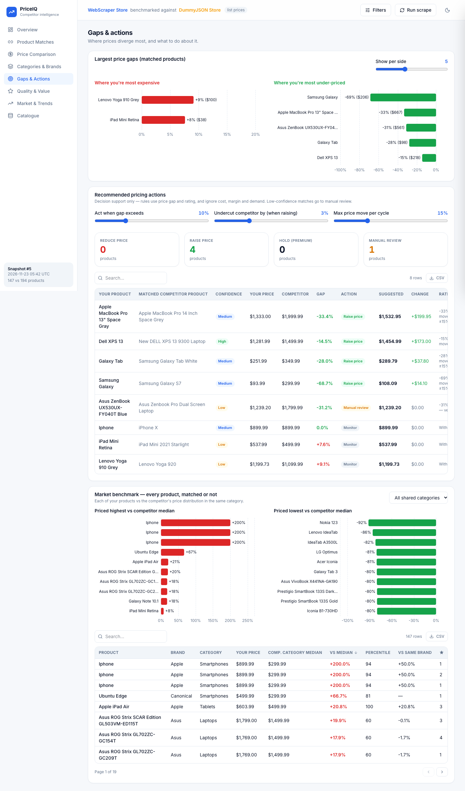

**Market & Trends** — price history across scrapes, competitor discounting and assortment structure.
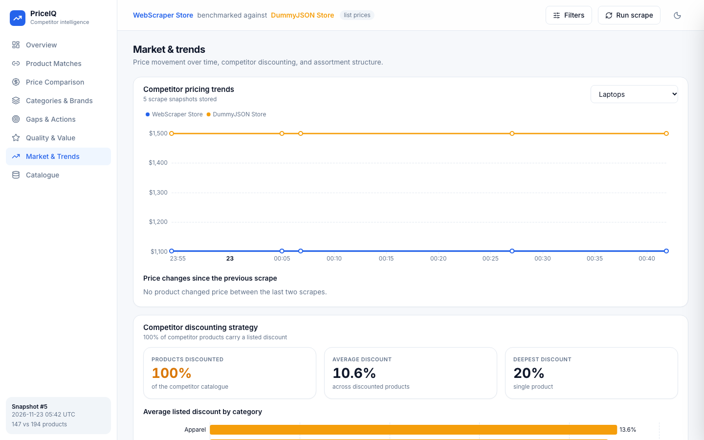

**Filters** — only business-level choices; dark mode is one click away.

| Filters drawer | Dark mode |
|---|---|
| 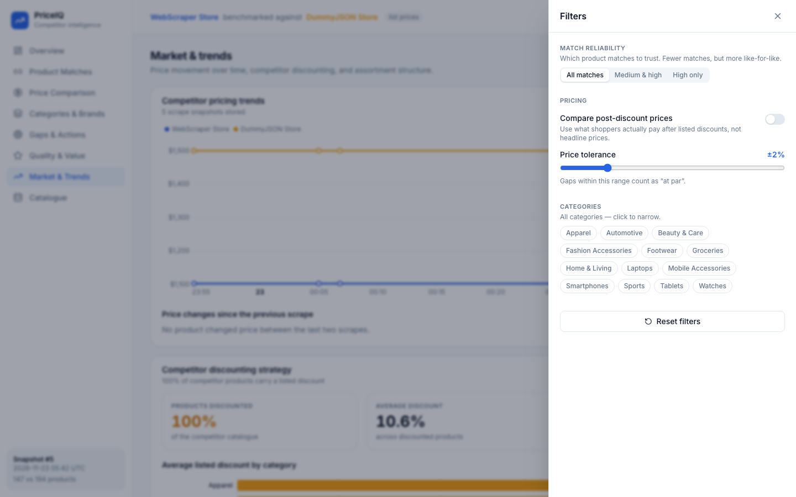 | 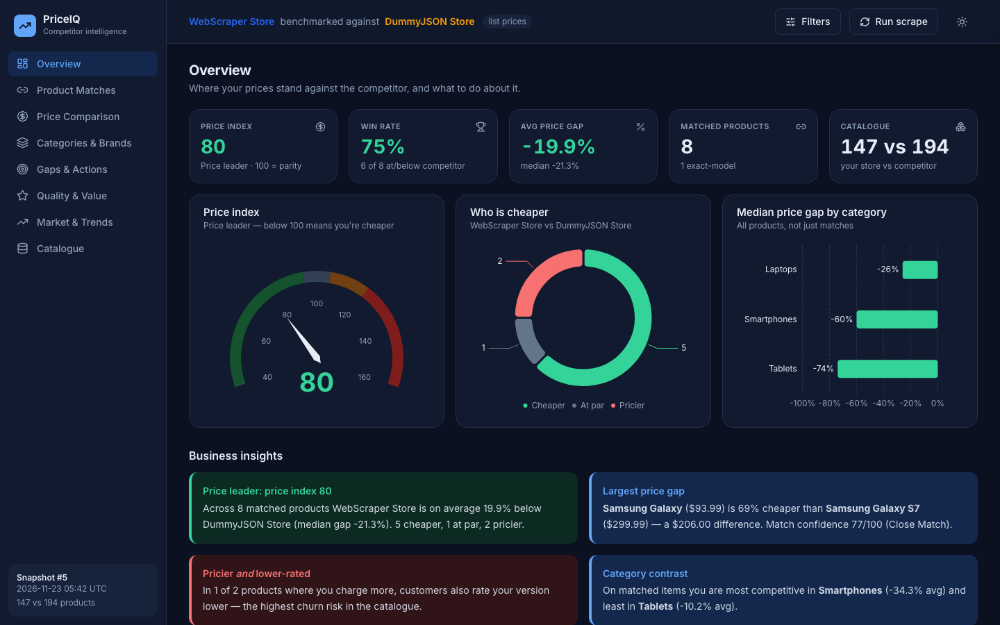 |

---

## 3. Where the data comes from (and an honest warning)

| Role in the app | Store | How it is collected | Where |
|---|---|---|---|
| **Your store** | "WebScraper Store" — the e-commerce *test site* of webscraper.io | HTML pages parsed with `requests` + `lxml`, following pagination | `https://webscraper.io/test-sites/e-commerce/static/{computers/laptops, computers/tablets, phones/touch}` |
| **Competitor** | "DummyJSON Store" — a demo store | One call to its public JSON API | `https://dummyjson.com/products?limit=0` |

Both are **public demo sites built for practising web scraping**. They were chosen because scraping them is allowed
(real retailers such as Amazon block bots and forbid scraping in their terms). Consequences you should know about:

* **The data is synthetic** — the sites say so themselves ("prices and ratings were randomly assigned"). The numbers
  show how the platform works; they are **not real market intelligence**.
* **The catalogues barely overlap** (about 147 vs 194 products, only ~8 matched pairs), so product-level
  conclusions are *directional*. That is why several pages analyse *all* products by category instead of only matches.
* The webscraper.io pages don't state a brand, so brands are inferred from product names (e.g. "Galaxy" → Samsung).

The architecture is source-agnostic: to benchmark real competitors you add one scraper class per site — see
[How to extend it](#13-how-to-extend-it).

---

## 4. Quick start

**You need:** Python 3.11+ (developed on 3.13), Node.js 20+ (developed on 23), and `make` (optional but convenient).

```bash
git clone <this repo> && cd Neebal_Scraping

make install     # creates backend/.venv, installs Python deps, runs `npm install` in frontend/
make scrape      # scrapes both stores once → backend/data/pricewatch.db   (~30 s)

# then, in two terminals:
make api         # terminal 1 → FastAPI backend on  http://localhost:8000   (API docs at /docs)
make web         # terminal 2 → React dev server on http://localhost:5173   ← open this one
```

No `make`? The equivalent commands are in the [Makefile](Makefile): `python3 -m venv backend/.venv && backend/.venv/bin/pip install -r backend/requirements.txt`,
`cd frontend && npm install`, `cd backend && .venv/bin/python -m app.scrapers.runner`,
`cd backend && .venv/bin/uvicorn app.main:app --reload --port 8000`, `cd frontend && npm run dev`.

**One-process "production" mode:** `make build` (compiles the React app into `frontend/dist/`) and then `make api`.
FastAPI now serves both the API and the built website at <http://localhost:8000>.

You can also skip `make scrape`: open the app and click **Run scrape** (the empty state offers it too).
Every scrape is saved as a new **snapshot**, so the more often you scrape, the richer the *Market & Trends* page gets.

---

## 5. How it works, end to end

The system has five stages. The first picture is the big picture; the two below zoom in on the two things that actually happen —
**collecting** data (when a scrape runs) and **viewing** it (every time someone opens a page or changes a filter).

**The big picture**

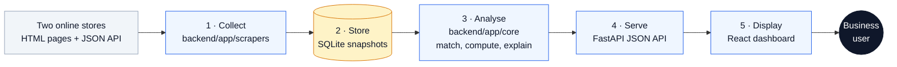

**Flow A — collecting data** (runs when you click *Run scrape* or run `make scrape`)

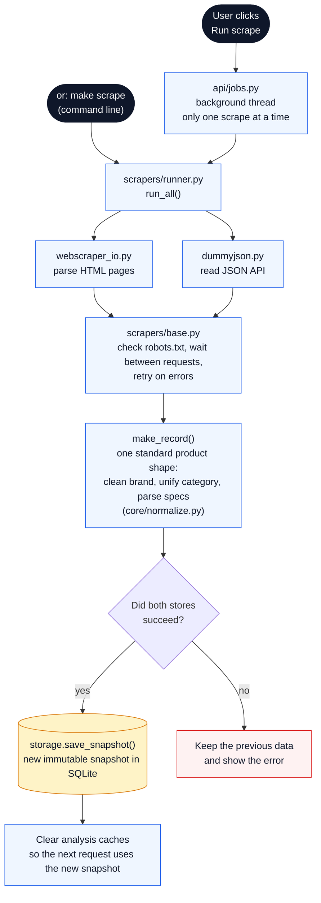

**Flow B — viewing data** (runs on every page load or filter change)

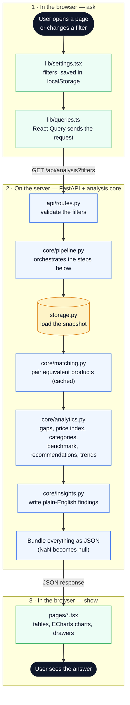

**Step by step**

1. **Scrape** — `scrapers/runner.py` runs each store's scraper. Each returns a list of product dictionaries in one common
   shape (name, price, brand, category, rating, …). Scrapers obey `robots.txt`, wait between requests, and retry on errors.
2. **Normalise** — while building each record, `core/normalize.py` canonicalises the brand, maps the store's own category
   names onto one shared category list (e.g. DummyJSON `mens-watches` → "Watches"), and parses specs (screen size, RAM,
   storage, CPU) out of free text.
3. **Store** — `storage.py` writes the whole run into SQLite as a new, immutable **snapshot**. Nothing is ever overwritten,
   which is what makes price *history* possible.
4. **Match** — `core/matching.py` pairs up equivalent products across the two stores (see [section 8](#8-the-matching-algorithm-in-detail)).
5. **Analyse** — `core/analytics.py` computes the gap per pair, the price index, category summaries, market benchmark,
   recommendations and trends; `core/insights.py` turns the numbers into sentences.
6. **Serve** — `core/pipeline.py` bundles everything into one JSON-safe dictionary for a given set of filters;
   `api/routes.py` exposes it over HTTP.
7. **Display** — the React app asks for `/api/analysis` whenever a filter changes and renders it.

Design principle: **`app/core/` knows nothing about the web.** It takes DataFrames/`Params` in and returns DataFrames/dicts
out, so it can be tested alone and reused by a CLI, notebook or different framework.

---

## 6. Key concepts (glossary)

| Term | Meaning |
|---|---|
| **Your store / Competitor** | Perspective of the analysis. By default *WebScraper Store* is "yours" and *DummyJSON Store* is the competitor. |
| **Snapshot** | One complete scrape of both stores, stored with a timestamp. The app analyses the newest snapshot by default. |
| **Matched pair** | A product from your store paired with its most similar product from the competitor. |
| **Match type** | **Equivalent** = same model · **Close Match** = same product family, different variant · **Comparable** = same brand/class, similar positioning. |
| **Confidence** | **High** (Equivalent) · **Medium** (Close Match with score ≥ 70) · **Low** (everything else). Lower confidence means the price gap may just reflect a product difference. |
| **Gap %** | `(your price − competitor price) ÷ competitor price × 100`. Negative = you are cheaper. |
| **Position** | **Cheaper** (gap below −tolerance), **At par** (within ± tolerance), **Pricier** (above +tolerance). |
| **Price tolerance** | The "at par" band, default ±2 %. Adjustable in Filters. |
| **Price index** | Average of `(your price ÷ competitor price) × 100` over matched pairs. **100 = parity**, below 100 = you are cheaper on average. Verdicts: < 95 *Price leader* · 95–105 *At market* · 105–120 *Premium priced* · > 120 *Well above market*. |
| **Win rate** | Share of matched pairs where you are cheaper **or** at par. |
| **Post-discount price** | List price × (1 − discount %). Filters let you compare what shoppers actually pay. |
| **Median price gap (category)** | Your category median price vs the competitor's, over **all** products (not just matches) — robust to a few extreme prices. |
| **Coverage** | For each category: *Both* stores sell it, *Only you*, or *Only competitor* (an assortment gap). |
| **Market benchmark** | For each of **your** products, where its price sits within the competitor's price distribution for that category (percentile). Works even for unmatched products. |
| **Max plausible price ratio** | Internal safety net (default 5×): a pair whose prices differ by more than 5× is dropped because it is almost certainly two different product classes, not a pricing signal. |

---

## 7. Project structure — every file explained

```
Neebal_Scraping/
├── README.md                     ← you are here
├── Makefile                      ← one-word shortcuts: install, scrape, api, web, build, test
├── .gitignore                    ← keeps venv, node_modules, build output and the local DB out of git
├── docs/screenshots/             ← the PNG screenshots shown in this README
├── backend/                      ← Python: scraping, analysis, HTTP API
│   ├── requirements.txt
│   ├── data/pricewatch.db        ← SQLite database created by the first scrape (git-ignored)
│   ├── app/
│   │   ├── main.py
│   │   ├── config.py
│   │   ├── storage.py
│   │   ├── api/      (routes.py, jobs.py)
│   │   ├── core/     (pipeline.py, matching.py, analytics.py, insights.py, normalize.py)
│   │   └── scrapers/ (base.py, webscraper_io.py, dummyjson.py, runner.py)
│   └── tests/        (test_core.py, test_api.py)
└── frontend/                     ← TypeScript: the dashboard
    ├── index.html, package.json, tsconfig.json, vite.config.ts
    └── src/
        ├── main.tsx, App.tsx, index.css
        ├── lib/        (api.ts, queries.ts, settings.tsx, theme.tsx, chartKit.ts, utils.ts)
        ├── components/ (Layout.tsx, SettingsPanel.tsx, DataTable.tsx, Chart.tsx, Drawer.tsx, ui.tsx)
        └── pages/      (Overview, Matches, Pricing, Categories, Actions, Quality, Market, Catalogue)
```

### 7.1 Root files

| File | Role |
|---|---|
| `README.md` | This documentation. |
| `Makefile` | Shortcuts so you don't have to remember long commands: `make install`, `scrape`, `api`, `web`, `build`, `test`. |
| `docs/screenshots/` | PNG screenshots of the running app used in this README (regenerate by re-capturing the pages). |
| `.gitignore` | Excludes `backend/.venv/`, `frontend/node_modules/`, `frontend/dist/`, `backend/data/*.db`, caches, logs. |

### 7.2 Backend — `backend/app/`

**Entry & configuration**

| File | Role and how it works |
|---|---|
| `main.py` | Creates the FastAPI application, enables CORS for the dev server (`localhost:5173`), mounts the API router from `api/routes.py`, and — **if `frontend/dist/` exists** — also serves the compiled React app (a "catch-all" route returns `index.html` so browser-side routing works). Run with `uvicorn app.main:app`. |
| `config.py` | Single place for settings: file paths (`DB_PATH`), the scraper's polite-crawling constants (user-agent, 0.25 s delay between requests, 20 s timeout, 3 retries), the registry `SOURCES` of stores (key, display name, URL, kind), the default "your store", and `COLUMNS` — the canonical list of fields every product record has. |
| `storage.py` | The only module that touches SQLite. `save_snapshot(df)` inserts a row in `snapshots` and all products with that `snapshot_id`; `list_snapshots()`, `load_snapshot(id)` (latest if omitted) and `load_history()` read data back as pandas DataFrames. Creates tables on first use. |

**`api/` — the HTTP layer (thin: parse input, call core, return JSON)**

| File | Role and how it works |
|---|---|
| `api/routes.py` | Defines every endpoint under `/api` (see [API reference](#10-api-reference)). `get_params()` turns query-string filters into a validated `pipeline.Params` object (rejecting unknown stores or match types with HTTP 400, out-of-range numbers with 422). Returns HTTP 409 if no scrape data exists yet. |
| `api/jobs.py` | Runs a scrape **in a background thread** so the UI doesn't freeze. Keeps one shared status dict (`idle / running / done / error`, progress 0–1, message). A lock guarantees only one scrape runs at a time; on success it clears the pipeline caches so the next request sees the new snapshot. |

**`core/` — the brain (no web framework imports)**

| File | Role and how it works |
|---|---|
| `core/pipeline.py` | The orchestrator. `Params` = every filter the UI can set. `build_context(params)` loads the snapshot, applies the price basis (list vs post-discount), runs matching (cached), builds pairs, applies confidence/category filters, and computes KPIs. `analysis()` wraps that into the big JSON payload the dashboard needs (KPIs, insights, pairs, categories, market data…); `recommendations()` and `catalog()` serve the other endpoints. `sanitize()` converts numpy/pandas values and `NaN` into JSON-safe Python values (browsers reject `NaN` in JSON). Uses `lru_cache` so changing a filter doesn't redo the slow matching. |
| `core/normalize.py` | Turns messy store data into a uniform shape: `canonical_brand` / `brand_from_name` / `resolve_brand` (sub-brand aliases: *Galaxy → Samsung*, *ThinkPad → Lenovo*), `unify_category` (maps each store's category names to a shared taxonomy and a department), `extract_specs` (regexes pull screen inches, RAM, storage, CPU from text — a lone "8GB" means RAM on a laptop but storage on a tablet), `clean_name` (lower-case, strip brand/punctuation) and `model_tokens` (model identifiers like `x441na`). |
| `core/matching.py` | Decides which products are "the same". `compute_matches(ours, comps, min_score, one_to_one)` scores every candidate pair **within the same category** using brand, fuzzy name, TF-IDF text and spec similarity, assigns a match type, and (optionally) uses the Hungarian algorithm so each competitor product is used at most once. Details in [section 8](#8-the-matching-algorithm-in-detail). **Price is never used for matching** (it would make the price comparison circular). |
| `core/analytics.py` | All the maths, as small pure functions: `apply_price_basis` (list vs effective price), `build_pairs` (joins matches with product data, computes `diff`, `pct_diff`, `position`, `confidence`, and drops implausible ratios), `kpis` + `price_verdict` (price index, win rate…), `category_summary`, `brand_category_matrix`, `market_benchmark`, `recommendations` ([section 9](#9-the-recommendation-rules)), `price_bands`, and the history helpers `category_trend` / `price_changes`. |
| `core/insights.py` | `build_insights()` converts numbers into short sentences with a tone (good / warn / bad / info): overall position, largest gap, "pricier **and** lower-rated" risk, strongest/weakest category, small-sample warning, assortment gaps, competitor discounting. Text uses `**bold**` / `*italic*`, which the frontend renders. |

**`scrapers/` — data collection**

| File | Role and how it works |
|---|---|
| `scrapers/base.py` | `BaseScraper`: everything a scraper needs so subclasses only parse pages. A shared HTTP session; **`allowed()`** reads the site's `robots.txt`; **`get()`** refuses disallowed URLs, waits between requests, and retries 429/5xx errors with growing back-off; **`make_record()`** builds the standard product dict (normalising brand/category, computing the post-discount price, extracting specs, stamping the scrape time). |
| `scrapers/webscraper_io.py` | Scrapes the webscraper.io test store: loops over the laptops / tablets / phones listing pages, follows `?page=N` until a page yields no *new* products (the site repeats its last page), and extracts name, price, description, image, rating (from a `data-rating` attribute) and review count with XPath. |
| `scrapers/dummyjson.py` | Calls DummyJSON's `/products?limit=0` once and maps its JSON fields (title, brand, price, `discountPercentage`, rating, reviews, stock…) to the standard record. |
| `scrapers/runner.py` | `run_all()` runs every scraper (one failing store doesn't stop the other), concatenates the results and saves a snapshot **only if all stores succeeded** (avoids half-empty snapshots). Also a CLI: `python -m app.scrapers.runner`. |

**`tests/`**

| File | Role |
|---|---|
| `tests/test_core.py` | Unit tests for brand aliases, spec extraction, category mapping, matching rules (category gate, tiers), price-gap maths, price index and the implausible-ratio filter. Uses tiny hand-made DataFrames — no network, no DB. |
| `tests/test_api.py` | API tests using FastAPI's `TestClient`: health, input validation (400/422), response shape, strict-JSON check (no `NaN`), perspective swap, and `min_confidence` filtering. Data-dependent tests skip themselves if no scrape exists. |

### 7.3 Frontend — `frontend/`

**Config files**

| File | Role |
|---|---|
| `index.html` | The single HTML page. Loads the Inter font, applies the saved dark/light theme *before* the app paints (prevents a white flash), and loads `src/main.tsx`. |
| `package.json` | Dependencies (React, React Router, TanStack Query & Table, ECharts, Tailwind, Lucide icons) and scripts (`dev`, `build`). |
| `tsconfig.json` | TypeScript strict-mode settings. |
| `vite.config.ts` | Vite build tool: React + Tailwind plugins, and a **dev proxy** that forwards `/api/*` to the backend on port 8000 (so the browser sees one origin and CORS never matters in dev). |

**`src/` entry points**

| File | Role |
|---|---|
| `main.tsx` | Mounts the React app into `#root`. |
| `App.tsx` | Wires the providers (react-query, theme, settings), and declares the URL → page routes inside the common `Layout`. |
| `index.css` | Tailwind import plus the **design tokens** (CSS variables for background, surface, border, text, brand/good/bad/warn colours) for light and dark themes, and the loading-skeleton animation. |

**`src/lib/` — logic shared by all pages**

| File | Role |
|---|---|
| `api.ts` | TypeScript types that mirror the API's JSON (`Analysis`, `Pair`, `CategoryRow`, `Market`, …) and the tiny `api()` fetch wrapper that throws a typed `ApiError` on HTTP errors. |
| `settings.tsx` | The **filters state** (React context), saved in `localStorage` so it survives reloads. `toQuery()` converts it into the API query string; `changedCount()` drives the badge on the Filters button. |
| `queries.ts` | React Query hooks that call the API: `useMeta`, `useAnalysisQuery` (keyed by the current filters, keeps the previous data on screen while refetching), `useRecommendations`, `useCatalog`, and `useScrape` (starts a scrape, polls status every 0.7 s, then switches to the new snapshot and refreshes everything). Also defines `AnalysisCtx` / `useAnalysis()` so pages can read the loaded data without refetching. |
| `theme.tsx` | Light/dark mode state (toggles the `dark` class on `<html>`, remembers the choice) and the chart colour palette for each mode. |
| `chartKit.ts` | Reusable ECharts building blocks (axis, grid, tooltip, legend styles; padding so bar labels aren't clipped; log-axis ticks) and the **dumbbell** chart (two dots per row joined by a line) used for price ladders and category comparisons. |
| `utils.ts` | Formatting (`money`, `pct`, `num`), `quantile`/`boxStats`, `groupBy`, and `downloadCsv` (builds a CSV in the browser). |

**`src/components/` — reusable building blocks**

| File | Role |
|---|---|
| `Layout.tsx` | The app shell: sidebar navigation, top bar (who vs whom, Filters button, Run-scrape button with live progress, theme toggle), and the data "gate" that shows a skeleton while loading, an empty state when there is no data, or an error message. Provides `AnalysisCtx` to every page. |
| `SettingsPanel.tsx` | The **Filters** drawer: match reliability, post-discount toggle, price tolerance, category chips, reset. |
| `DataTable.tsx` | A generic table (TanStack Table): click-to-sort headers, global search, pagination, optional row click, CSV export of the filtered rows. |
| `Chart.tsx` | A thin wrapper around Apache ECharts: creates the chart, re-applies options when data/theme change, resizes with its container, and disposes on unmount. Only the needed ECharts modules are imported to keep the bundle smaller. |
| `Drawer.tsx` | Slide-in side panel (closes on overlay click or Esc) used by Filters and the side-by-side product view. |
| `ui.tsx` | The small design system: `Card`, `Badge`, `Button`, `KpiCard`, `InsightCard` (+ a mini-markdown renderer), `Toggle`, `Slider`, `Segmented`, `Select`, `Pills`, `Stars`, `PageHeader`, `Skeleton`, `EmptyState`, `Grid`. |

**`src/pages/` — one file per sidebar item** (each reads the shared `Analysis` object and builds its charts/tables)

| File | Shows | Backend data used |
|---|---|---|
| `Overview.tsx` | KPIs, gauge, donut, category gap bars, insights | `kpis`, `categories`, `insights`, `meta` |
| `Matches.tsx` | Pairs table + side-by-side drawer | `pairs` |
| `Pricing.tsx` | Scatter, price ladder, per-category winner table | `pairs` |
| `Categories.tsx` | Median prices, category/brand gaps, summary table | `categories`, `brand_category` |
| `Actions.tsx` | Biggest gaps, recommendations, market benchmark | `pairs`, `benchmark`, plus `/api/recommendations` |
| `Quality.tsx` | Price-vs-rating quadrant, value map | `pairs`, `ratings` |
| `Market.tsx` | Trends, discounts, assortment, price tiers, stock | `market`, `categories` |
| `Catalogue.tsx` | Full product lists | `/api/catalog` |

---

## 8. The matching algorithm in detail

Goal: for each of your products, find the same or most similar competitor product — **without using price**.

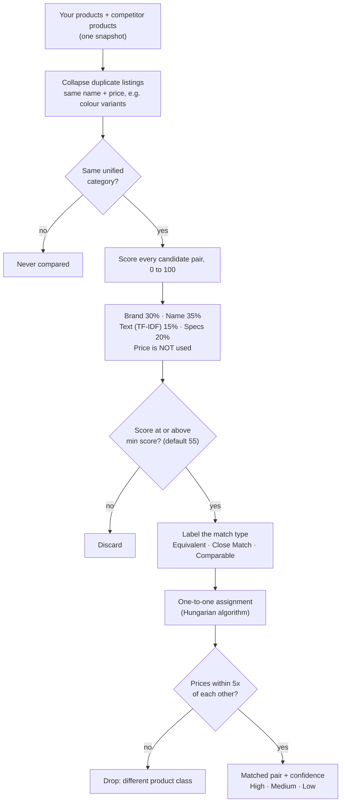

The same steps in words:

1. **Pre-clean.** Products listed several times with identical name + price (colour variants such as three "Iphone" rows)
   are collapsed to one representative so they are not paired with three different competitor items.
2. **Category gate.** A product can only match products in the same unified category (laptops with laptops …).
3. **Score every candidate pair (0–100):**

   | Signal | Weight | How it is computed |
   |---|---|---|
   | Brand | 30 % | 1 if the canonical brands are equal, else 0 |
   | Name | 35 % | RapidFuzz: average of *token-sort* and *token-set* ratios on brand-stripped lower-case names |
   | Text | 15 % | TF-IDF cosine similarity of "name + description" (scikit-learn) |
   | Specs | 20 % | Share of comparable specs that agree: screen size (±0.5″ full credit), RAM and storage (ratio), CPU family. If a spec isn't stated on both sides it is skipped and the other weights are renormalised (score × 0.95 to avoid rewarding missing evidence) |

4. **Assign a match type:** *Equivalent* if brands agree **and** (they share a model token such as `xps 13`, or the order-insensitive
   name similarity ≥ 0.92) **and** specs don't contradict; else *Close Match* if brands agree and name similarity ≥ 0.70; else *Comparable*.
5. **Threshold.** Pairs below `min_score` (default 55) are discarded.
6. **One-to-one (default).** The Hungarian algorithm (`scipy.optimize.linear_sum_assignment`) chooses the set of pairs with the
   best total score such that each competitor product is used at most once. Without it, 20 different Dell laptops would all
   "match" the one Dell on the other site.
7. **Later, in `analytics.build_pairs`:** pairs with a price ratio above 5× are dropped as different product classes, and each pair gets a
   *confidence* label (High / Medium / Low).

---

## 9. The recommendation rules

On *Gaps & Actions*, each matched pair gets one suggested action (decision support only — it ignores your costs, margins and demand):

| Condition (gap = your price vs competitor) | Action |
|---|---|
| Match confidence is **Low** and \|gap\| > threshold | **Manual review** — the difference may just be a different product |
| Gap > +threshold **and** you are rated ≥ 0.5★ higher | **Hold** — the premium looks justified |
| Gap > +threshold (no rating advantage) | **Reduce price** towards ≈ 5 % above the competitor |
| Gap < −threshold | **Raise price** towards (competitor − undercut margin) |
| Otherwise | **Monitor** |

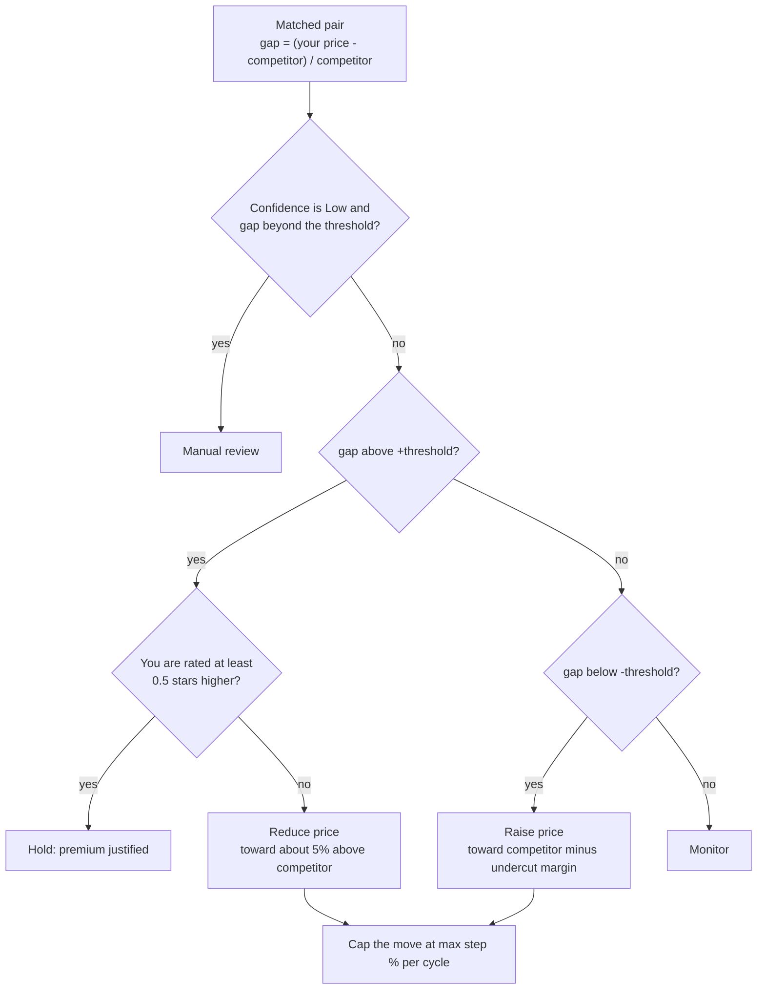

Three sliders control the policy: *act when gap exceeds* (default 10 %), *undercut by* (3 %), and *max move per cycle* (15 % — suggested
prices never move more than this in one step).

---

## 10. API reference

Base URL `http://localhost:8000`. Interactive docs (Swagger) at **`/docs`**.

| Method & path | Purpose |
|---|---|
| `GET /api/health` | Liveness check → `{"status":"ok"}` |
| `GET /api/meta` | Stores, snapshots, category list, match types, `has_data` flag |
| `GET /api/analysis` | The complete analysis for the given filters (see below) |
| `GET /api/recommendations` | Pricing actions. Extra params: `thr` (default 10), `margin` (3), `step` (15) |
| `GET /api/catalog?store=ours\|competitor` | Full product list of one store |
| `POST /api/scrape` | Start a background scrape (returns `202`; if one is running, `already_running: true`) |
| `GET /api/scrape/status` | `{state: idle\|running\|done\|error, progress, message, errors, snapshot_id}` |

**Filter parameters** (shared by `analysis`, `recommendations`, `catalog`)

| Param | Default | Meaning |
|---|---|---|
| `effective` | `false` | Compare post-discount prices |
| `tol` | `2` | "At par" tolerance in % (0–50) |
| `scope` | *(all)* | Comma-separated categories |
| `min_confidence` | `Low` | `Low` = all matches · `Medium` · `High` |
| `ours` | `webscraper` | Which store is "yours" *(advanced, not in the UI)* |
| `snapshot` | latest | Snapshot id to analyse *(advanced)* |
| `min_score` | `55` | Minimum match score 0–100 *(advanced)* |
| `types` | all three | Allowed match types, comma-separated *(advanced)* |
| `one_to_one` | `true` | Enforce one-to-one matching *(advanced)* |
| `max_ratio` | `5` | Max plausible price ratio *(advanced)* |

**`/api/analysis` response keys:** `meta` (names, snapshot, counts) · `kpis` (price index, win rate, verdict …) · `insights` ·
`pairs` (one object per matched pair) · `categories` · `brand_category` · `brands` · `benchmark` · `ratings` · `market`
(discounts, assortment, price bands, low-stock list, trend series, price changes). Errors: `400` bad value, `409` no data yet, `422` out of range.

---

## 11. Database

SQLite file `backend/data/pricewatch.db` (created automatically, git-ignored).

* **`snapshots`** — `snapshot_id` (auto), `scraped_at` (UTC ISO time), `n_products`.
* **`products`** — one row per product *per snapshot*: `snapshot_id`, `source`, `product_id`, `name`, `brand`, `category`, `department`,
  `raw_category`, `price`, `discount_pct`, `effective_price`, `currency`, `description`, `image_url`, `url`, `rating`, `review_count`,
  `availability`, `stock`, `screen_in`, `ram_gb`, `storage_gb`, `cpu`, `scraped_at`.

Delete the file to start fresh; the next scrape recreates it.

---

## 12. Frontend architecture

* **Single source of truth for filters:** `settings.tsx` (persisted). Changing a filter changes the React Query *key*, which triggers a new
  `/api/analysis` request; the previous result stays on screen (dimmed) until the new one arrives, so the UI never flashes empty.
* **One request feeds all pages:** `Layout.tsx` fetches the analysis once and provides it through `AnalysisCtx`; pages just read it with
  `useAnalysis()`. Only *Recommendations* (policy sliders) and *Catalogue* make their own requests.
* **Charts** are declarative ECharts option objects built with `useMemo` in each page, styled by helpers in `chartKit.ts` and coloured from the theme palette,
  so light and dark modes both look right.
* **Scraping from the UI:** the *Run scrape* button POSTs to `/api/scrape`, polls `/api/scrape/status`, and when the job reports `done` switches to the newest
  snapshot and refetches everything.
* **Styling:** Tailwind CSS utility classes + CSS variables for theming (see `index.css`).

---

## 13. How to extend it

**Benchmark a real competitor (add a store)** — only for sites whose terms permit scraping:
1. Create `backend/app/scrapers/mystore.py` with a class extending `BaseScraper` (`source_key`, `source_name`, `base_url`) and a `scrape()` method that returns a list of `self.make_record(...)` dicts. For JavaScript-rendered sites, drive Playwright inside `scrape()`.
2. Register it in `backend/app/config.py` (`SOURCES`) and in `SCRAPERS` in `backend/app/scrapers/runner.py`.
3. Add any new category names to `_CATEGORY_MAP` and brand aliases to `_ALIASES` in `core/normalize.py`.
4. (The app compares exactly two stores at a time; with more, extend `competitor_of()` in `core/pipeline.py` and add a store selector in the UI.)

**Add a new dashboard page:** add a component in `frontend/src/pages/`, a route in `App.tsx`, and a link in the `NAV` list in `components/Layout.tsx`. Use `useAnalysis()` for data. If you need a new number, compute it in `core/analytics.py`, include it in `core/pipeline.analysis()`, and add the field to the types in `lib/api.ts`.

**Add a filter:** add the field to `Params` (`core/pipeline.py`) and `get_params` (`api/routes.py`), then to `Settings`/`toQuery` (`lib/settings.tsx`) and a control in `SettingsPanel.tsx`.

**Keep history growing:** schedule `make scrape` (e.g. daily cron) — the *Market & Trends* page draws a line per snapshot.

---

## 14. Testing & commands

| Command | What it does |
|---|---|
| `make test` | Backend `pytest` + frontend TypeScript check |
| `make install` | Create venv, install Python and npm dependencies |
| `make scrape` | One scrape → new snapshot |
| `make api` / `make web` | Backend (port 8000) / frontend dev server (port 5173) |
| `make build` | Production build of the frontend into `frontend/dist/` |

---

## 15. Limitations, ethics & troubleshooting

**Limitations**
* Demo data (synthetic prices/ratings) and a small overlap between the two catalogues → few matched pairs.
* Matching is heuristic: some pairs are approximate (e.g. a generic "Iphone" paired with "iPhone X"). The confidence label and the
  *Match reliability* filter exist for this reason.
* Recommendations ignore cost, margin and demand; they are suggestions, not decisions.
* Trend charts need at least two snapshots, and the demo stores' prices don't change between scrapes, so lines are flat.
* The frontend bundle is ~1 MB (≈ 350 KB gzipped); fine locally, but the chart code could be split for a public deployment.

**Scraping ethics** — scrapers identify themselves, honour `robots.txt`, throttle and back off. Only point them at sites whose terms allow automated access.

**Troubleshooting**

| Symptom | Fix |
|---|---|
| Page says "No data yet" | Click **Run scrape** or run `make scrape`. |
| "Couldn't load analysis" / blank charts | The backend isn't running — start `make api` (port 8000). |
| `409` from the API | No snapshot exists yet; scrape first. |
| Scrape button shows "Scrape failed" | Check your internet connection; hover the message for details. The previous data is kept. |
| `make: command not found` | Use the equivalent commands listed in [Quick start](#4-quick-start). |
| Changed filters seem "stuck" | Filters persist in your browser; open Filters → **Reset filters**. |
